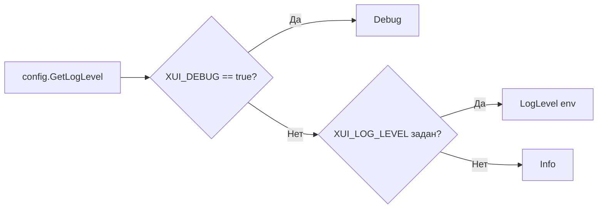

# Конфигурация рантайма (`config/config.go`)

Пакет [`config`](../../config/config.go) отвечает за централизованное управление конфигурационными параметрами приложения: версионированием бинарника, уровнем детализации логов, определением путей файловой системы в зависимости от операционной системы и переменных окружения.

---

## 1. Встраивание метаданных и версионирование

В пакете используется механизм Go `//go:embed` для связывания статических метаданных приложения непосредственно с бинарным файлом во время компиляции:

```go
//go:embed version
var embeddedVersion string

//go:embed name
var name string

var version string
```

### Приоритеты разрешения версии (`config.GetVersion()`)

1. **`ldflags` инъекция:** При сборке дистрибутива передается флаг:
   ```bash
   go build -ldflags "-X 'github.com/coinman-dev/3ax-ui/v2/config.version=v1.2.3'"
   ```
2. **Встроенный файл `version`:** Если сборка выполнялась без `ldflags` (например, при локальной разработке через `go run`), значение извлекается из `embeddedVersion`.
3. **Нормализация префикса:** Функция `GetVersion()` автоматически удаляет лидирующий символ `v` (`strings.TrimPrefix(v, "v")`), исключая дублирование префиксов в UI-шаблонах.

---

## 2. Переменные окружения и уровни логирования

Приложение настраивается через набор переменных окружения. В таблице приведены все поддерживаемые переменные и их поведение:

| Переменная окружения | Дефолт (Linux) | Дефолт (Windows) | Описание |
| :--- | :--- | :--- | :--- |
| `XUI_LOG_LEVEL` | `info` | `info` | Базовый уровень логирования консоли (`debug`, `info`, `notice`, `warning`, `error`). |
| `XUI_DEBUG` | `false` | `false` | При установке в `true` принудительно активирует уровень `debug` независимо от `XUI_LOG_LEVEL`. |
| `XUI_BIN_FOLDER` | `bin` | `bin` | Каталог расположения исполняемых файлов сайдкаров (`xray`, `mtg`). |
| `XUI_DB_FOLDER` | `/etc/x-ui` | Папка с бинарником (`getBaseDir()`) | Каталог размещения базы данных SQLite. |
| `XUI_LOG_FOLDER` | `/var/log/x-ui` | `./log` | Каталог для постоянного файла журнала `3xui.log`. |

### Иерархия уровней логирования



Тип `config.LogLevel` реализует строковое перечисление:
```go
type LogLevel string

const (
    Debug   LogLevel = "debug"
    Info    LogLevel = "info"
    Notice  LogLevel = "notice"
    Warning LogLevel = "warning"
    Error   LogLevel = "error"
)
```

---

## 3. Кроссплатформенное разрешение путей

### Определение рабочего каталога (`config.getBaseDir()`)
Функция вычисляет реальное местоположение бинарного файла через `os.Executable()`. 
Если бинарник запущен из временного каталога Go (например, при вызове тестов или `go run`, пути содержат `/appdata/local/temp/` или `/go-build`), функция автоматически переключается на текущую рабочую директорию через `os.Getwd()`.

### Путь к базе данных (`config.GetDBPath()`)
Формируется динамически на основе имени приложения и целевой папки:
```go
func GetDBPath() string {
    return fmt.Sprintf("%s/%s.db", GetDBFolderPath(), GetName())
}
```
*На Linux по умолчанию:* `/etc/x-ui/3ax-ui.db`.

### Механизм обратной совместимости в Windows (`init()`)
Функция `init()` содержит автоматическую миграцию для Windows-сред:
- Если переменная `XUI_DB_FOLDER` не установлена, а база данных отсутствует в локальном каталоге, но существует в устаревшем пути `/etc/x-ui/3ax-ui.db`, рантайм копирует существующий файл в локальную папку без потери настроек.

---

## 4. Справочник API функций

| Сигнатура | Возвращаемый тип | Назначение |
| :--- | :--- | :--- |
| `GetVersion()` | `string` | Возвращает очищенную строку версии (без префикса `v`). |
| `GetName()` | `string` | Возвращает имя сервиса (`3ax-ui`). |
| `GetLogLevel()` | `LogLevel` | Возвращает эффективный уровень логов с учетом debug-флагов. |
| `IsDebug()` | `bool` | Проверяет флаг отладочного режима. |
| `GetBinFolderPath()`| `string` | Путь к папке бинарников ядер. |
| `GetDBFolderPath()` | `string` | Каталог расположения БД с учетом OS. |
| `GetDBPath()` | `string` | Полный путь к файлу SQLite `.db`. |
| `GetLogFolder()` | `string` | Каталог для записи файлов журнала. |
