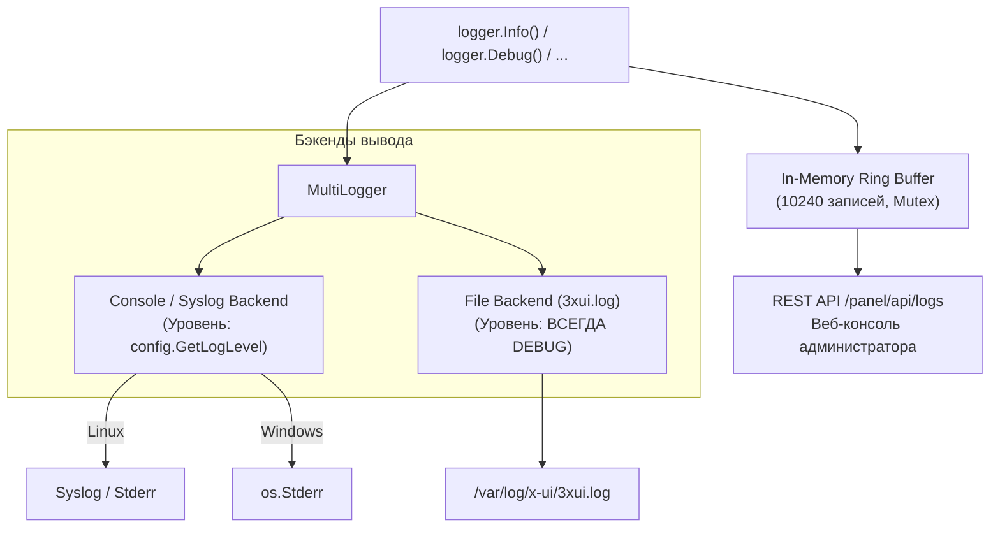
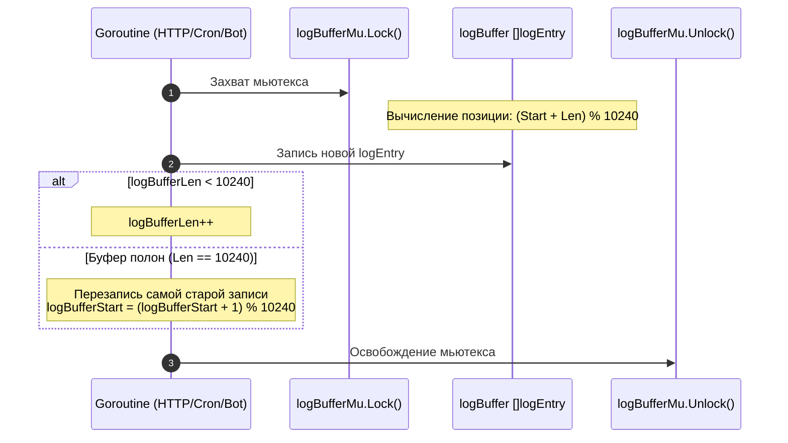

# Подсистема логирования (`logger/logger.go`)

Пакет [`logger`](../../logger/logger.go) реализует централизованную систему протоколирования 3AX-UI на основе библиотеки `op/go-logging`. Подсистема обеспечивает одновременный вывод сообщений в два независимых бэкенда с разными уровнями фильтрации, а также поддерживает кольцевой in-memory буфер для просмотра логов в реальном времени через веб-интерфейс панели.

---

## 1. Архитектура Dual-Backend

При инициализации функции `logger.InitLogger(level)` создаются и объединяются через `logging.MultiLogger` два бэкенда:



### 1.1. Консольный бэкенд (`initDefaultBackend`)
- **На Linux:** Сначала предпринимается попытка подключения к системному демону `syslog` (`logging.NewSyslogBackend("")`). При отсутствии демона переключается на стандартный поток ошибок `os.Stderr`.
- **На Windows:** Вывод направляется напрямую в `os.Stderr` с автоматическим добавлением меток времени `2006/01/02 15:04:05`.
- **Фильтрация:** Применяется уровень, переданный в `InitLogger(level)` (по умолчанию `INFO` или `DEBUG` при `XUI_DEBUG=true`).

### 1.2. Файловый бэкенд (`initFileBackend`)
- Файл лога создается по пути `filepath.Join(config.GetLogFolder(), "3xui.log")` (на Linux: `/var/log/x-ui/3xui.log`).
- Каталог создается с правами `0750`, а сам файл открывается с флагами `os.O_CREATE | os.O_WRONLY | os.O_TRUNC` и правами `0660`.
- **Гарантированный DEBUG:** Независимо от уровня консоли, файловый логгер всегда настраивается на уровень `logging.DEBUG`, гарантируя наличие полного дампа диагностики при сбоях.

---

## 2. Потокобезопасный Ring-буфер для Web UI

Для отображения системных событий в веб-панели реализован кольцевой буфер фиксированного размера без накладных расходов на аллокацию памяти при переполнении.

### Структура данных

```go
const maxLogBufferSize = 10240

type logEntry struct {
    time  string
    level logging.Level
    log   string
}

var (
    logBufferMu    sync.Mutex
    logBuffer      = make([]logEntry, maxLogBufferSize)
    logBufferStart int // Индекс старейшей записи
    logBufferLen   int // Текущее количество валидных записей (<= 10240)
)
```

### Алгоритм циклической вставки (`addToBuffer`)



В отличие от устаревшего слайсового подхода (`logBuffer = logBuffer[1:]` + `append`), циклическое кольцо предотвращает реаллокацию и сдвиг 10240 элементов в памяти на каждый вызов логгера.

### Чтение записей (`GetLogs`)

```go
func GetLogs(c int, level string) []string
```
- Обходит кольцевой буфер в обратном порядке (от самых свежих записей к более старым).
- Выполняет фильтрацию: возвращаются только те записи, чей численный уровень `entry.level <= logLevel` (где `DEBUG=5`, `INFO=4`, `NOTICE=3`, `WARNING=2`, `ERROR=1`).

---

## 3. Справочник методов логирования

Все функции логирования одновременно направляют сообщение в подсистему `go-logging` и добавляют нормализованную запись в кольцевой буфер веб-панели:

| Метод | Сигнатура | Уровень | Попадание в буфер |
| :--- | :--- | :---: | :---: |
| `logger.Debug` | `Debug(args ...any)` | `DEBUG` | Да |
| `logger.Debugf` | `Debugf(format string, args ...any)` | `DEBUG` | Да |
| `logger.Info` | `Info(args ...any)` | `INFO` | Да |
| `logger.Infof` | `Infof(format string, args ...any)` | `INFO` | Да |
| `logger.Warning` | `Warning(args ...any)` | `WARNING` | Да |
| `logger.Warningf` | `Warningf(format string, args ...any)` | `WARNING` | Да |
| `logger.Error` | `Error(args ...any)` | `ERROR` | Да |
| `logger.Errorf` | `Errorf(format string, args ...any)` | `ERROR` | Да |
| `logger.CloseLogger`| `CloseLogger()` | — | Сброс и закрытие дескриптора файла |

---

## 4. Разбор юнит-тестов (`logger_test.go`)

Файл [`logger/logger_test.go`](../../logger/logger_test.go) содержит два критически важных теста надежности:

### 4.1. `TestBufferConcurrentAccess`
Тест проверяет устойчивость кольцевого буфера к состоянию гонки (`race condition`) при высокой конкурентной нагрузке:
- Запускаются **8 параллельных горутин-писателей** (эмулирующих одновременную работу Xray-core, Telegram-бота, HTTP-запросов и 10-секундных cron-задач). Каждая горутина генерирует 500 записей (суммарно 4000 вызовов).
- Параллельно работают **4 горутины-читателя**, непрерывно опрашивающие `GetLogs(50, "debug")` (эмуляция веб-браузеров администраторов).
- **Результат:** Тестирование с флагом `-race` подтверждает отсутствие повреждения заголовков слайсов и гарантирует потокобезопасность чтения и записи.

### 4.2. `TestBufferWrapsAround`
Тест валидирует корректность циклического переполнения:
- В пустой буфер последовательно записывается `maxLogBufferSize + 100` записей (10340 записей с метками `entry-0` ... `entry-10339`).
- Проверяется, что `logBufferLen` строго равен `10240`.
- Проверяется, что индекс начала кольца `logBufferStart` сместился ровно на `100`.
- Метод `GetLogs(1, "error")` возвращает самую последнюю добавленную запись `entry-10339`.
