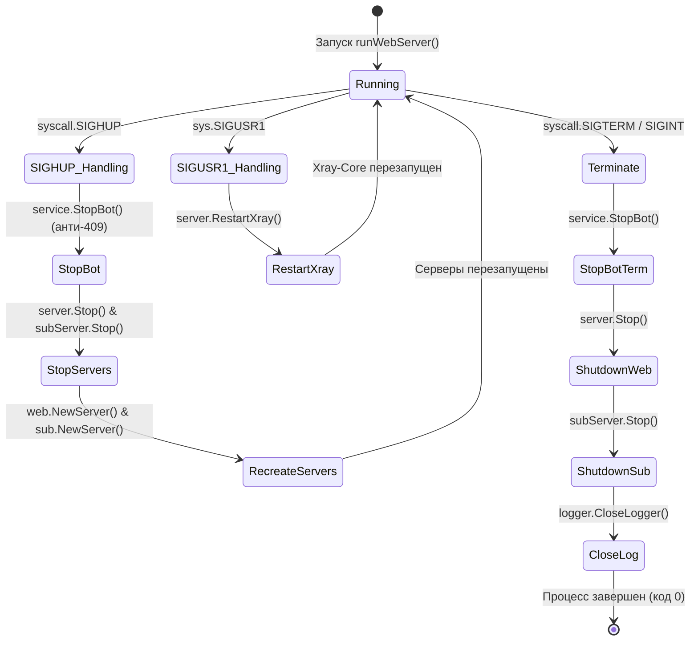

# Точка входа и рантайм (`main.go`)

Файл [`main.go`](../../main.go) является главной точкой входа в приложение 3AX-UI. Он отвечает за парсинг CLI-флагов, маршрутизацию консольных подкоманд, инициализацию базы данных SQLite, запуск веб-сервера и сервера подписок, а также за диспетчеризацию сигналов операционной системы (`SIGHUP`, `SIGTERM`, `sys.SIGUSR1`).

---

## 1. Архитектура запуска и подкоманд

При вызове бинарного файла `main.main()` анализирует переданные аргументы командной строки `os.Args`:

```mermaid
flowchart TD
    Start([Запуск процесса 3AX-UI]) --> CheckArgs{len(os.Args) < 2 ?}
    
    CheckArgs -->|Да (без аргументов)| RunDefault[runWebServer]
    CheckArgs -->|Нет| ParseFlag[flag.Parse / Проверка -v]
    
    ParseFlag --> IsVersion{-v ?}
    IsVersion -->|Да| PrintVer[Вывод версии config.GetVersion] --> Exit([Выход])
    IsVersion -->|Нет| SwitchCmd{os.Args 1}
    
    SwitchCmd -->|"run"| RunServer[runWebServer]
    SwitchCmd -->|"migrate"| MigrateDB[migrateDb]
    SwitchCmd -->|"awg-gen2"| AWGGen2[generateAwg2]
    SwitchCmd -->|"setting"| SettingCmd[Настройки панели]
    SwitchCmd -->|"cert"| CertCmd[Настройка SSL сертификатов]
    SwitchCmd -->|Иное| Usage[Вывод справки usage] --> Exit
```

### Сводная таблица сабкоманд CLI

| Сабкоманда | Функция | Описание и назначение |
| :--- | :--- | :--- |
| *(без аргументов)* | `main.runWebServer()` | Запуск панели в штатном режиме фонового сервера. |
| `run` | `main.runWebServer()` | Явный запуск веб-панели и сервера подписок. |
| `migrate` | `main.migrateDb()` | Запуск автомиграций базы данных из старых версий x-ui / 3x-ui. |
| `awg-gen2` | `main.generateAwg2()` | Первичная генерация параметров обфускации AmneziaWG 2.0 в БД при чистой установке. |
| `setting` | `main.updateSetting()`, `main.resetSetting()` | Управление портами, базовым URL, учетными записями админа и Telegram-ботом. |
| `cert` | `main.updateCert()` | Привязка SSL/TLS сертификатов (открытого и закрытого ключа) к панели и серверу подписок. |

---

## 2. Детальный разбор функций

### 2.1. `main.runWebServer()`
Основная функция рантайма. Выполняет:
1. Определение и активацию уровня логирования:
   ```go
   switch config.GetLogLevel() {
   case config.Debug:
       logger.InitLogger(logging.DEBUG)
   // ...
   }
   ```
2. Загрузку переменных окружения из файла `.env` через `godotenv.Load()`.
3. Инициализацию пула SQLite базы данных через `database.InitDB(config.GetDBPath())`.
4. Создание и запуск инстанса веб-сервера `web.NewServer()`, регистрацию в `global.SetWebServer(server)`.
5. Создание и запуск dual-stack сервера подписок `sub.NewServer()`.
6. Регистрацию канала перехвата системных сигналов:
   ```go
   sigCh := make(chan os.Signal, 1)
   signal.Notify(sigCh, syscall.SIGHUP, syscall.SIGTERM, sys.SIGUSR1)
   ```
7. Блокирующий цикл обработки сигналов (см. [Жизненный цикл и сигналы](../guide/lifecycle.md)).

### 2.2. `main.generateAwg2()`
Используется скриптом [`install.sh`](../deployment/install-script.md) при **чистой установке**:
- Подключается к базе данных SQLite.
- Ищет первый сервер туннеля типа `model.TunnelKindAwg`.
- Вызывает `tunnel.GenerateObfuscation20("default")` для генерации криптостойких параметров обфускации:
  - Мусорные пакеты: `Jc`, `Jmin`, `Jmax`.
  - Смещения заголовков: `S1`, `S2`, `S3`, `S4`.
  - Магические константы: `H1`, `H2`, `H3`, `H4`.
  - Инициализирующие байты: `I1`.
- Сохраняет сгенерированные значения в таблицу `tunnel_servers`.

::: warning Отличие fresh install от update
Команда `awg-gen2` вызывается только при первой инсталляции. При выполнении [`update.sh`](../deployment/update-script.md) эта команда намеренно пропускается, чтобы сохранить уже действующие параметры туннелей пользователей.
:::

### 2.3. `main.migrateDb()`
Выполняет низкоуровневые миграции базы данных:
- Инициализирует подключение через `database.InitDB()`.
- Делегирует выполнение в `service.InboundService.MigrateDB()`.
- Выполняет трансформацию структур старых инбаундов и таблиц трафика.

### 2.4. `main.updateSetting()`
Параметры функции CLI-конфигуратора:

```go
func updateSetting(port int, username string, password string, webBasePath string, listenIP string, resetTwoFactor bool) error
```

| Параметр | Тип | Действие |
| :--- | :--- | :--- |
| `port` | `int` | Изменение порта прослушивания веб-панели через `settingService.SetPort()`. |
| `username` / `password` | `string` | Обновление учетных данных первой учетной записи через `userService.UpdateFirstUser()`. |
| `webBasePath` | `string` | Установка базового префикса URL панели (например, `/secret-path/`). |
| `listenIP` | `string` | Привязка к конкретному IP-адресу хоста (`settingService.SetListen()`). |
| `resetTwoFactor` | `bool` | Сброс двухфакторной аутентификации TOTP (`SetTwoFactorEnable(false)`, очистка токена). |

### 2.5. `main.updateCert()`
Привязка SSL/TLS сертификатов для обеспечения HTTPS:
- Проверяет обязательность парного ввода (публичный сертификат `webCert` и приватный ключ `webCertKey`).
- Применяет сертификаты одновременно к веб-панели (`SetCertFile`, `SetKeyFile`) и к автономному серверу подписок (`SetSubCertFile`, `SetSubKeyFile`).

---

## 3. Обработка сигналов операционной системы



::: danger Защита от конфликта Telegram 409
Критически важным аспектом реализации `main.go` является гарантированная остановка сессии Telegram Long Polling (`service.StopBot()`) **до** остановки и пересоздания веб-сервера. Без этого повторное подключение бота при рестарте вызовет фатальный конфликт `409 Conflict` на стороне Telegram Bot API.
:::
