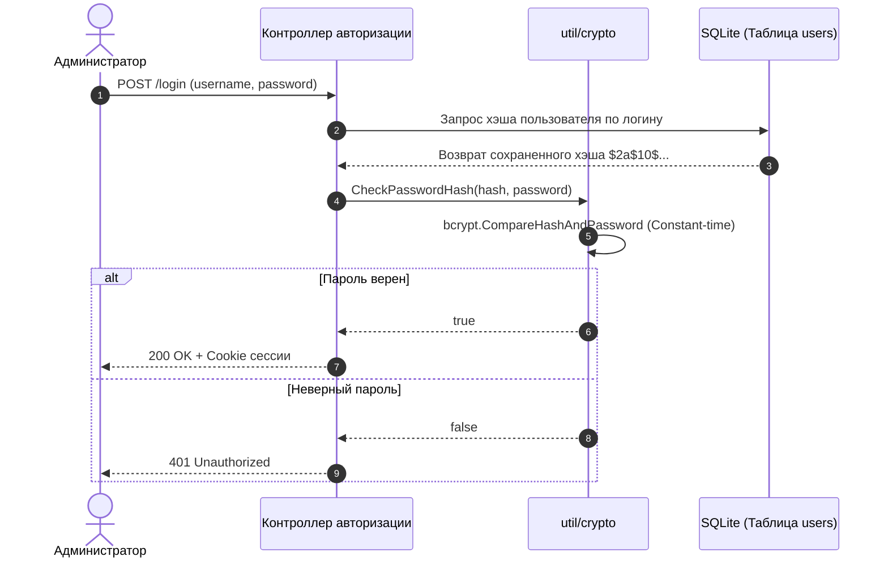

# Криптография и генерация случайных последовательностей (`util/crypto`, `util/random`)

Безопасность аутентификации администраторов и генерации клиентских учетных записей обеспечивается связкой криптографических утилит bcrypt и генераторов на базе энтропии ядра ОС `crypto/rand`.

---

## 1. Хэширование паролей bcrypt (`util/crypto/crypto.go`)

Файл [`util/crypto/crypto.go`](../../../util/crypto/crypto.go) инкапсулирует алгоритмы хэширования паролей администратора панели с защитой от тайминг-атак и атак по радужным таблицам:

```go
func HashPasswordAsBcrypt(password string) (string, error)
func CheckPasswordHash(hash, password string) bool
```

### Детали реализации

- **Алгоритм:** Blowfish-based adaptive hashing (`bcrypt.GenerateFromPassword`).
- **Сложность (Cost):** Используется `bcrypt.DefaultCost` (коэффициент 10, что соответствует $2^{10} = 1024$ итерациям сжатия), обеспечивая баланс между устойчивостью к брутфорсу на GPU и производительностью сервера при авторизации.
- **Верификация:** Метод `CheckPasswordHash` вызывает `bcrypt.CompareHashAndPassword`, гарантируя устойчивость к тайминг-атакам за счет сравнения за константное время.



---

## 2. Криптографически стойкая генерация (`util/random/random.go`)

Файл [`util/random/random.go`](../../../util/random/random.go) реализует генераторы случайных строк и чисел, использующие источник энтропии ядра операционной системы `crypto/rand.Reader` (`/dev/urandom` в Linux или `CryptGenRandom` / `BCryptGenRandom` в Windows).

### Инициализация таблиц символов (`init`)

При загрузке пакета формируются фиксированные массивы рун для исключения аллокаций в рантайме:

| Массив | Размер | Содержимое |
| :--- | :---: | :--- |
| `numSeq` | 10 | Цифры `0`–`9` |
| `lowerSeq` | 26 | Строчные латинские буквы `a`–`z` |
| `upperSeq` | 26 | Прописные латинские буквы `A`–`Z` |
| `numLowerSeq` | 36 | Цифры + строчные буквы |
| `numUpperSeq` | 36 | Цифры + прописные буквы |
| `allSeq` | 62 | Полный алфавит (`0`–`9`, `a`–`z`, `A`–`Z`) |

### Функции генерации

#### `random.Seq(n int) string`
Генерирует криптографически стойкую псевдослучайную строку длины `n` из набора `allSeq`:
```go
func Seq(n int) string {
    runes := make([]rune, n)
    for i := range n {
        idx, err := rand.Int(rand.Reader, big.NewInt(int64(len(allSeq))))
        if err != nil {
            panic("crypto/rand failed: " + err.Error())
        }
        runes[i] = allSeq[idx.Int64()]
    }
    return string(runes)
}
```
*Применение:* Генерация уникальных токенов сессий, паролей по умолчанию, секретов подписок и клиентских идентификаторов.

#### `random.Num(n int) int`
Генерирует случайное целое число в полуинтервале $[0, n)$:
```go
func Num(n int) int {
    bn := big.NewInt(int64(n))
    r, err := rand.Int(rand.Reader, bn)
    if err != nil {
        panic("crypto/rand failed: " + err.Error())
    }
    return int(r.Int64())
}
```
*Применение:* Выбор свободных случайных портов для инбаундов и туннелей, рандомизация смещений заголовков обфускации AmneziaWG.
