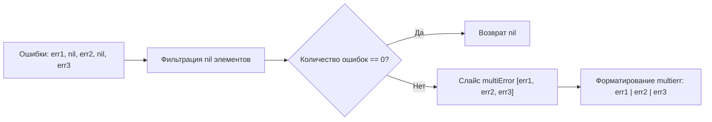

# Вспомогательные утилиты (`util/*`)

Модуль вспомогательных утилит объединяет критически важные примитивы форматирования данных, агрегации ошибок, кастомной сериализации JSON и инспекции структур данных.

---

## 1. Обработка системных ошибок (`util/common/err.go`)

Файл [`util/common/err.go`](../../../util/common/err.go) предоставляет легковесные обертки для создания форматированных ошибок и перехвата фатальных сбоев (`panic`):

### API интерфейса ошибок

| Функция | Сигнатура | Описание |
| :--- | :--- | :--- |
| `common.NewError` | `NewError(a ...any) error` | Создает объект `error` с форматированием через `fmt.Sprintln`. |
| `common.NewErrorf` | `NewErrorf(format string, a ...any) error` | Создает объект `error` с форматированием по шаблону через `fmt.Sprintf`. |
| `common.Recover` | `Recover(msg string) any` | Безопасный перехватчик паник (`recover()`). При наличии переданного сообщения логирует стектрейс через `logger.Error(msg, "panic:", panicErr)`. |

```go
// Пример использования Recover в фоновых горутинах:
go func() {
    defer common.Recover("Background worker encountered panic")
    // фоновая работа...
}()
```

---

## 2. Форматирование трафика (`util/common/format.go`)

Файл [`util/common/format.go`](../../../util/common/format.go) реализует бинарное масштабирование байтов трафика:

```go
func FormatTraffic(trafficBytes int64) string
```

Алгоритм последовательно делит значение на `1024` с точностью до 2 знаков после запятой, сопоставляя соответствующий суффикс единиц измерения:
`"B"`, `"KB"`, `"MB"`, `"GB"`, `"TB"`, `"PB"`.

```text
1024 Bytes      ➔  "1.00KB"
1073741824 B    ➔  "1.00GB"
```

---

## 3. Агрегатор множественных ошибок (`util/common/multi_error.go`)

Файл [`util/common/multi_error.go`](../../../util/common/multi_error.go) реализует паттерн Multi-Error, позволяющий собирать ошибки при выполнении пакетных операций (например, массовый рестарт туннелей или сброс квот группы пользователей) без преждевременного прерывания цикла:

```go
type multiError []error
```

### Механика объединения (`common.Combine`)



- Метод `multiError.Error()` соединяет все текстовые сообщения разделителем `" | "` с префиксом `"multierr: "`.
- Функция `Combine(maybeError ...error) error` отсеивает `nil` ошибки. Если ошибок не возникло, возвращается `nil` интерфейсного типа `error`.

---

## 4. Кастомная сериализация JSON (`util/json_util/json.go`)

Файл [`util/json_util/json.go`](../../../util/json_util/json.go) решает специфическую проблему совместимости Xray JSON-схемы с пустыми слайсами:

```go
type RawMessage []byte
```

### Специфика сериализации пустых срезов
По стандарту Go пустой срез байтов или структур при маршалинге преобразуется в `"[]"`. Однако конфигурационный компилятор ядра Xray для определенных параметров (например, пустые списки правил маршрутизации или опциональные настройки протоколов) ожидает `null`:

```go
func (m RawMessage) MarshalJSON() ([]byte, error) {
    if len(m) == 0 {
        return []byte("null"), nil
    }
    return m, nil
}
```

При обратной десериализации `UnmarshalJSON` данные копируются с переиспользованием базового слайса `append((*m)[0:0], data...)`, снижая нагрузку на GC.

---

## 5. Инспекция полей структур (`util/reflect_util/reflect.go`)

Файл [`util/reflect_util/reflect.go`](../../../util/reflect_util/reflect.go) предоставляет вспомогательную функцию для динамического анализа моделей:

```go
func GetFields(t reflect.Type) []reflect.StructField
```

Итерирует по количеству полей переданного типа (`t.NumField()`) и возвращает готовый срез `[]reflect.StructField`. Используется внутренними валидаторами и генераторами форм веб-панели при сопоставлении полей конфигурационных структур с базой данных.
