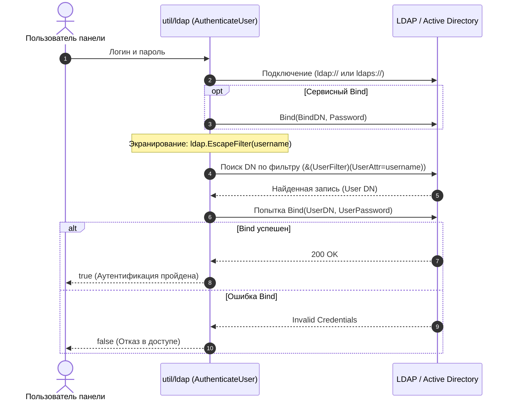

# LDAP клиент и аутентификация (`util/ldap/ldap.go`)

Пакет [`ldaputil`](../../../util/ldap/ldap.go) реализует интеграцию панели 3AX-UI с корпоративными каталогами пользователей Active Directory / OpenLDAP. Пакет обеспечивает аутентификацию администраторов в веб-панели и периодическую синхронизацию статусов доступа пользователей VLESS/VMess по атрибутам каталога.

---

## 1. Конфигурация подключения (`ldaputil.Config`)

Структура конфигурации определяет сетевые параметры и правила сопоставления атрибутов схемы каталога:

```go
type Config struct {
    Host       string   // IP-адрес или домен LDAP-сервера
    Port       int      // Порт (389 для ldap, 636 для ldaps)
    UseTLS     bool     // Флаг использования защищенного TLS соединения
    BindDN     string   // DN сервисной учетной записи для поиска
    Password   string   // Пароль сервисной учетной записи
    BaseDN     string   // Базовый DN поиска (например: dc=example,dc=com)
    UserFilter string   // LDAP-фильтр выборки (по умолчанию: (objectClass=person))
    UserAttr   string   // Атрибут идентификатора (по умолчанию: mail или uid)
    FlagField  string   // Атрибут флага доступа (по умолчанию: vless_enabled)
    TruthyVals []string // Набор строковых значений, интерпретируемых как true
    Invert     bool     // Инвертировать ли полученный статус активности
}
```

---

## 2. Алгоритмы и функции

### 2.1. Аутентификация пользователя (`AuthenticateUser`)

Функция выполняет безопасную двухэтапную проверку подлинности учетных данных администратора:



::: tip Защита от LDAP-инъекций
Для защиты от внедрения вредоносных фильтров имя пользователя строго экранируется с помощью функции `ldap.EscapeFilter(username)`.
:::

### 2.2. Синхронизация статусов доступа (`FetchVlessFlags`)

Используется периодической фоновой задачей [web/job/ldap_sync_job.go](../../jobs/maintenance.md) для массовой синхронизации состояния клиентских профилей:

```go
func FetchVlessFlags(cfg Config) (map[string]bool, error)
```

1. Подключается к каталогу и выполняет subtree-поиск в рамках `BaseDN`.
2. Извлекает пары атрибутов: `UserAttr` (email/логин) и `FlagField` (флаг доступа).
3. Сопоставляет значение атрибута со списком `TruthyVals` (например, `["TRUE", "1", "enabled"]`).
4. При установленном флаге `Invert` инвертирует логическое значение (полезно при проверке атрибутов блокировки, например `accountDisabled`).
5. Возвращает карту `map[string]bool`, сопоставляющую email пользователя со статусом активности.
