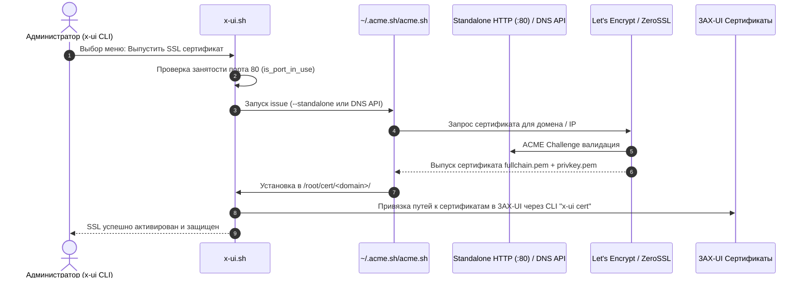

# Консольная утилита управления (`x-ui.sh`)

Скрипт [`x-ui.sh`](../../x-ui.sh) предоставляет интерактивный текстовый интерфейс (CLI) для повседневного администрирования сервера 3AX-UI. Утилита вызывается из командной строки командой `x-ui`.

---

## 1. Функциональные возможности терминального меню

```text
  3AX-UI Панель управления (CLI Меню)
  ----------------------------------------
  1. Запустить панель
  2. Остановить панель
  3. Перезапустить панель (мягкий рестарт)
  4. Проверить статус службы
  5. Просмотреть логи (access / error / iplimit)
  ----------------------------------------
  6. Сбросить имя пользователя и пароль администратора
  7. Сбросить настройки панели по умолчанию
  8. Изменить порт панели
  9. Изменить базовый путь URL (BasePath)
  ----------------------------------------
  10. Управление SSL сертификатами (ACME.sh)
  11. Управление лимитами IP (iplimit)
  12. Проверка занятости сетевых портов
  13. Обновить 3AX-UI до актуальной версии
  14. Деинсталлировать панель
```

---

## 2. Интеграция с ACME.sh и выпуск сертификатов

Скрипт содержит встроенную интеграцию с клиентом `acme.sh` для автоматического получения и продления бесплатных SSL/TLS сертификатов Let's Encrypt и ZeroSSL:



### Поддерживаемые типы сертификатов:
- **Доменные сертификаты:** Стандартный выпуск через Standalone HTTP сервер (на 80 порту) или через DNS API (Cloudflare, DuckDNS и др.).
- **IP-сертификаты:** Выпуск сертификатов для публичных IP-адресов через ZeroSSL (устанавливаются в `/root/cert/ip`).
- **Автоматический cron:** Создается фоновое задание планировщика для бесшовного продления каждые 60 дней.

---

## 3. Мониторинг сетевых сокетов и логов

- **Проверка портов (`is_port_in_use`):** Утилита опрашивает сетевые утилиты `ss`, `netstat` и `lsof`, предупреждая администратора о конфликтах до смены портов.
- **Инспекция журналов:** Прямой просмотр файлов логов:
  - Журнал доступа клиентов Xray: `/var/log/x-ui/access.log`
  - Журнал ошибок ядра: `/var/log/x-ui/error.log`
  - Журнал срабатывания ограничений по IP: `/var/log/x-ui/3xipl.log`
  - Список заблокированных IP-адресов: `/var/log/x-ui/3xipl-banned.log`
