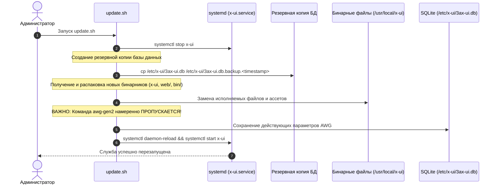

# Скрипт обновления (`update.sh`)

Скрипт [`update.sh`](../../update.sh) предназначен для безопасного обновления работающей панели 3AX-UI до актуальной версии без потери клиентских данных, настроек туннелей и статистики трафика.

---

## 1. Порядок выполнения обновления



---

## 2. Безопасность данных и сохранение конфигурации

### 2.1. Резервное копирование SQLite
Перед заменой исполняемого файла скрипт создает снимок базы данных:
```bash
cp /etc/x-ui/3ax-ui.db /etc/x-ui/3ax-ui.db.backup_$(date +%Y%m%d_%H%M%S)
```
В случае непредвиденных сбоев администратор может восстановить предыдущее состояние одной командой.

### 2.2. Сохранение параметров обфускации AmneziaWG
В отличие от первичного инсталлятора [`install.sh`](install-script.md), скрипт обновления **не вызывает** сабкоманду `awg-gen2`. Это принципиальное решение:
- Все действующие клиенты AmneziaWG сохраняют свои ключи, мусорные пакеты и заголовки обфускации.
- Профили на смартфонах и ПК пользователей продолжают работать без необходимости повторного импорта `.conf` файлов.

### 2.3. Поддержка ветки разработки (`--beta` / `--pre`)
При передаче флагов обновления:
```bash
./update.sh --beta
# или
./update.sh --pre
```
Скрипт переключается на ветку `dev`, скачивая предварительные сборки панели и сопутствующих утилит.
