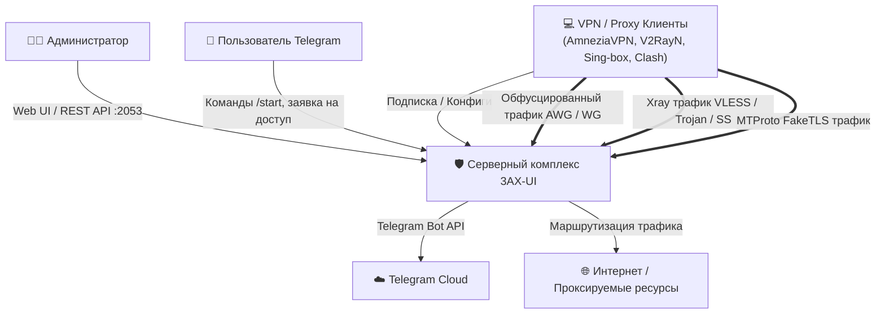
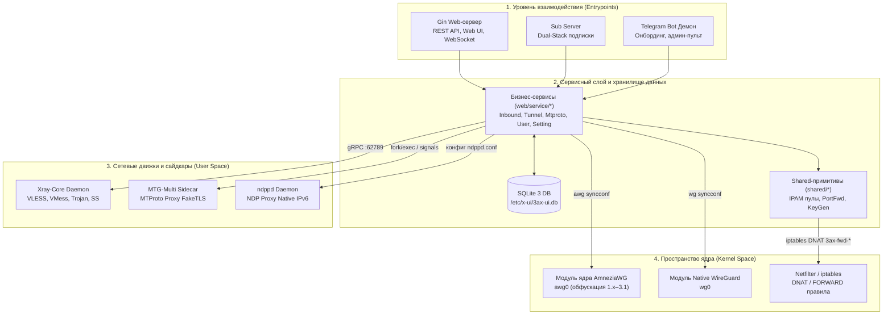

# Системная архитектура 3AX-UI

Панель **3AX-UI** представляет собой высокопроизводительный серверный комплекс для централизованного управления прокси-протоколами и VPN-туннелями с глубокой интеграцией в ядро Linux.

Комплекс объединяет движок **Xray-Core**, модуль ядра **AmneziaWG** (версии 1.x–3.1) и **Native WireGuard**, сайдкары **MTProto Proxy** (`mtg` / `mtg-multi`), независимый dual-stack сервер подписок, систему Telegram-онбординга и REST API.

---

## 1. Архитектурная модель C4 (Container Diagram)

## 1. Архитектурная модель C4

Для наглядного представления архитектура разделена на два уровня: **Контекст системы** (взаимодействие с внешними клиентами) и **Контейнеры хоста** (взаимодействие внутренних демонов и ядра).

### 1.1. Уровень 1: Контекст системы (System Context)

Определяет внешних акторов и их точки взаимодействия с платформой 3AX-UI:



---

### 1.2. Уровень 2: Контейнеры и процессы хоста (Container Diagram)

Показывает внутреннее устройство хоста Linux: разделение на сетевые демоны, сервисный слой Golang, базу данных и пространство ядра (Kernel Space):



---

## 2. Иерархия слоев (Layered Architecture)

Вся кодовая база строго разделена на 5 уровней абстракции с однонаправленным потоком зависимостей:

```text
Level 0: Bootstrap & Runtime (main, config, logger, util, deployment)
   │
   ▼
Level 1: Storage & Shared Primitives (database, model, shared/ipam, portfwd, ndppd)
   │
   ▼
Level 2: Core Protocol Engines (tunnel/awg, tunnel/wg, xray, mtproto, sub)
   │
   ▼
Level 3: Business Services & Background Jobs (web/service, web/job)
   │
   ▼
Level 4: Presentation & Consumers (web/controller, bot, web/html)
```

| Слой | Каталоги | Назначение и зона ответственности |
| :--- | :--- | :--- |
| **Level 0** | `main.go`, `config/`, `logger/`, `util/`, `install.sh` | Инициализация среды, парсинг CLI аргументов, конфигурация путей, ротация логов, системные сигналы и инсталляторы. |
| **Level 1** | `database/`, `database/model/`, `shared/` | Доступ к SQLite через GORM, схема реляционных связей, управление IP-пулами (IPAM), правила `iptables` и генератор ключей Curve25519. |
| **Level 2** | `tunnel/`, `xray/`, `mtproto/`, `sub/` | Низкоуровневые движки: генерация параметров обфускации AmneziaWG (1.x–3.1), компиляция JSON для Xray, gRPC клиент статистики, запуск сайдкаров `mtg` и формирование подписок. |
| **Level 3** | `web/service/`, `web/job/` | Бизнес-логика панели: CRUD клиентов, транслитерация кириллических имен, учет лимитов трафика, cron-демоны (каждые 10с), сторожевой таймер Xray. |
| **Level 4** | `web/controller/`, `bot/`, `web/html/` | Точки взаимодействия: REST API маршруты `/panel/api/*`, интерактивный Telegram-бот, Web UI страницы и WebSocket рассылка телеметрии. |

---

## 3. Ключевые архитектурные решения

### 3.1. Ампутация NAT66 и переход на Native IPv6 (NDP Proxy)
В отличие от стандартных панелей управления, 3AX-UI не использует NAT66 для IPv6 клиентов WireGuard/AmneziaWG. Вместо этого:
1. Выделяется реальная публичная подсеть IPv6 (например `/64` или `/80`).
2. Встроенный сервис [ndppd](/shared/ndppd) перехватывает запросы Neighbor Solicitation на внешнем WAN интерфейсе хоста и анонсирует IPv6-адреса клиентов туннелей.
3. Клиенты получают полноценный чистый IPv6-адрес без маскарадинга.

### 3.2. Обфускация AmneziaWG поколений 1.x, 2.0 и 3.x
Архитектура туннелей поддерживает три поколения параметров обфускации:
- **AWG 1.x:** Мусорные пакеты инициализации (`Jc`, `Jmin`, `Jmax`) и фиксированные сдвиги заголовков (`S1`, `S2`, `H1`–`H4`).
- **AWG 2.0:** Расширенные смещения (`S3`, `S4`), динамические диапазоны `H1`–`H4`, параметр `I1` и байты `I2`–`I5`.
- **AWG 3.0 / 3.1:** Криптографическая защита заголовков потоковым шифром ChaCha20 через `HeaderProtectionKey`, рандомизированные трейлеры (`RandomTrailers`) и плавающие таймеры `CookieTimeout`.

### 3.3. Telegram Bot и защита от конфликта 409
Для предотвращения состояния гонки Telegram Long Polling при горячем перезапуске панели по сигналу `SIGHUP` (код ошибки HTTP 409 Conflict):
- Реализован скоординированный вызов [service.StopBot()](/bot/architecture), который разрывает сессию с Telegram API до остановки слушателей веб-сервера.
- Инициализация нового экземпляра бота выполняется строго после поднятия HTTP-эндпоинтов.

### 3.4. Изоляция процессов и Healing Daemon
Все внешние движки изолированы:
- **Xray-Core** работает как дочерний процесс и опрашивается через локальный gRPC сокет (`127.0.0.1:62789`).
- Туннели **AmneziaWG** и **WireGuard** конфигурируются напрямую через сетевой стек ядра (`netlink` и `syncconf`). В фоне работает [Healing Daemon](/protocols/tunnel/healing-daemon), который раз в минуту сверяет статус интерфейсов и автоматически восстанавливает упавшие линки при сбоях сетевого стека или перезапуске NetworkManager/systemd-networkd.
