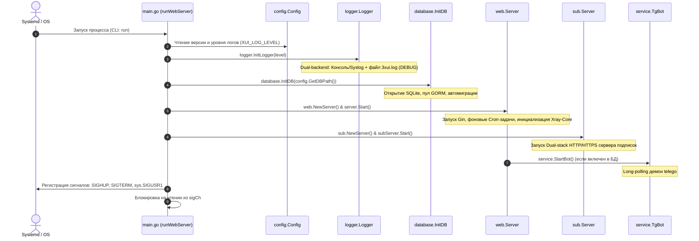

# Жизненный цикл и системные сигналы

Управление жизненным циклом демона 3AX-UI сосредоточено в функции `main.runWebServer()` файла [`main.go`](/core/main). Архитектура построена на бесконечном цикле мультиплексирования системных сигналов ядра ОС (`SIGHUP`, `SIGTERM`, `sys.SIGUSR1`), обеспечивая бесшовный перезапуск сетевых слушателей и фоновых служб без обрыва сессий клиентов.

---

## 1. Последовательность инициализации (Boot Sequence)

При запуске бинарника с сабкомандой `run` (или без параметров по умолчанию) выполняется строгая цепочка предварительных операций:



---

## 2. Матрица обработки сигналов ОС

Для перехвата сигналов используется канал `sigCh := make(chan os.Signal, 1)` с подпиской через `signal.Notify`:

| Сигнал | Источник | Обработчик в `main.go` | Поведение и последствия |
| :--- | :--- | :--- | :--- |
| **`syscall.SIGHUP`** | `systemctl reload`, `x-ui reload` | `server.Stop()`, `subServer.Stop()`, пересоздание инстансов | Полный мягкий перезапуск веб-сервера и сервера подписок. Вызывается `service.StopBot()` для исключения ошибки 409 Telegram. Туннели ядра AWG/WG **не прерываются**. |
| **`sys.SIGUSR1`** | Пользовательский сигнал, хуки обновления конфигураций | `server.RestartXray()` | Мягкий перезапуск только ядра **Xray-Core**. Веб-панель, сессии администратора и туннели остаются активными. |
| **`syscall.SIGTERM` / `SIGINT`** | `systemctl stop`, `Ctrl+C` | `default:` ветка в `switch sig` | Корректное завершение работы: `service.StopBot()`, `server.Stop()`, `subServer.Stop()`, сброс буферов `logger.CloseLogger()`, выход из процесса (`return`). |

::: tip Кроссплатформенность SIGUSR1
На Linux `sys.SIGUSR1` представляет стандартный `syscall.SIGUSR1`. На Windows используется синтетический полифилл из пакета [`util/sys/sys_windows.go`](/core/utils/sys), предотвращающий ошибки компиляции.
:::

---

## 3. Механизм перезапуска SIGHUP и защита от ошибки Telegram 409

При отправке сигнала `SIGHUP` происходит горячая перезагрузка всех сетевых слушателей:

```mermaid
sequenceDiagram
    autonumber
    actor Admin as Администратор / Cron
    participant Main as main.go (Event Loop)
    participant Bot as service.StopBot()
    participant OldWeb as Старый web.Server
    participant OldSub as Старый sub.Server
    participant NewWeb as Новый web.Server
    participant NewSub as Новый sub.Server

    Admin->>Main: kill -HUP <PID>
    Note over Main: Обработка syscall.SIGHUP
    Main->>Bot: service.StopBot()
    Note over Bot: Остановка long-polling, закрытие контекста telego
    Main->>OldWeb: OldWeb.Stop()
    Note over OldWeb: Закрытие HTTP-сокетов Gin, остановка cron-задач
    Main->>OldSub: OldSub.Stop()
    Note over OldSub: Закрытие портов сервера подписок
    Main->>NewWeb: server = web.NewServer(); server.Start()
    Note over NewWeb: Открытие портов, запуск фоновых демонов, старт Bot
    Main->>NewSub: subServer = sub.NewServer(); subServer.Start()
    Note over NewSub: Поднятие dual-stack HTTP/HTTPS
```

::: danger Защита от конфликта Telegram Polling (HTTP 409)
Telegram Bot API строго запрещает параллельные сессии Long Polling с одним токеном. Если старый экземпляр бота не остановить до инициализации нового, Telegram возвращает фатальную ошибку `409 Conflict: terminated by other getUpdates request`. 
Вызов `service.StopBot()` перед `server.Stop()` гарантирует сброс сетевого подключения к серверам Telegram перед стартом нового экземпляра.
:::

---

## 4. Завершение работы (Graceful Shutdown)

При получении сигнала `SIGTERM` процесс гарантирует сохранность данных:
1. Завершается сессия Telegram-бота (`service.StopBot()`).
2. Веб-сервер закрывает входящие TCP-соединения (`server.Stop()`), дожидаясь завершения активных REST-запросов.
3. Сервер подписок освобождает порты (`subServer.Stop()`).
4. Дескриптор файла журнала `3xui.log` сбрасывается на диск и закрывается через `logger.CloseLogger()`.
5. Процесс завершается с кодом 0.
